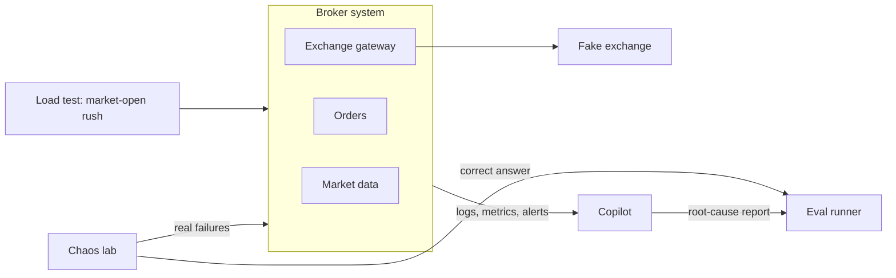

# Incident Copilot

An AI on-call engineer. When a system breaks, it reads the alert, checks logs and metrics with
read-only tools, and writes a report with the root cause, the evidence and a suggested fix.

The repo also contains the system it watches, a **stock broker app at market open**, and a
**chaos lab** that breaks it on purpose. Because every failure is caused on purpose, every
copilot run has a known correct answer, so every answer gets an exact score, time and cost.

> **Status:** Phase 1, week 1 (Nov 2026). Building the broker system. Nothing runs yet.

## How it works

- **Broker system:** 3 services (Market data, Orders, Exchange gateway) with Postgres and a read
  replica, Redis, Kafka and circuit breakers. It sends orders to a fake exchange.
- **Chaos lab:** causes real failures, such as replica lag or a slow exchange, and records the true cause.
- **Copilot:** investigates with read-only tools and writes a root-cause report. It never sees the true cause.
- **Eval runner:** compares the report with the true cause and scores every run.

## Version 1 targets

| What | Target | Measured |
|---|---|---|
| Correct root cause | at least 14 of 20 runs | not yet |
| Time from alert to report | under 2 minutes | not yet |
| Cost per incident | under ₹10 | not yet |
| Broker p95 latency in the market-open rush | under 300 ms | not yet |

Every "not yet" will be replaced with a measured number.

## Repo layout

| Folder | What is inside |
|---|---|
| `services/` | The broker system: Market data, Orders (Java), Exchange gateway, fake exchange |
| `copilot/` | The AI agent and its read-only tools |
| `chaos/` | Starts and undoes the real failures |
| `eval/` | The correct answers and the scorer |
| `infra/` | Config for Postgres, Kafka, Redis and Nginx |
| `contracts/` | Formats shared by Python and Java, such as the log format |
| `libs/` | Small shared Python code |
| `docs/` | Design doc and decision log |
| `tests/` | Tests for the whole repo |

## Getting started

Coming in week 1.

## Tech stack

Python (FastAPI) for most parts, Java (Spring Boot) for the Orders service. Postgres with one
read replica, Redis, Kafka, Nginx, Prometheus, Loki, Grafana, k6 and Toxiproxy. Docker Compose
to run everything, GitHub Actions for CI.

## Roadmap

1. Broker system, chaos lab and monitoring
2. One AI agent with read-only tools
3. 30 to 50 test scenarios run in CI, plus an AI support assistant with AI failures
4. Train a small open model on the agent's own runs and compare it with GPT
5. Several agents working together, with human approval for risky fixes

## License

MIT